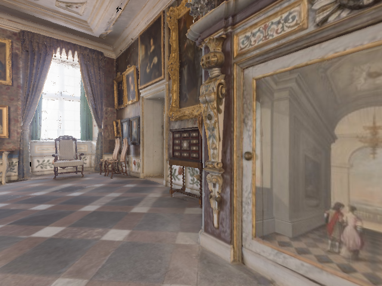
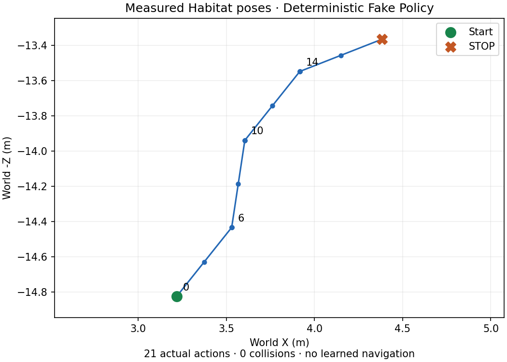
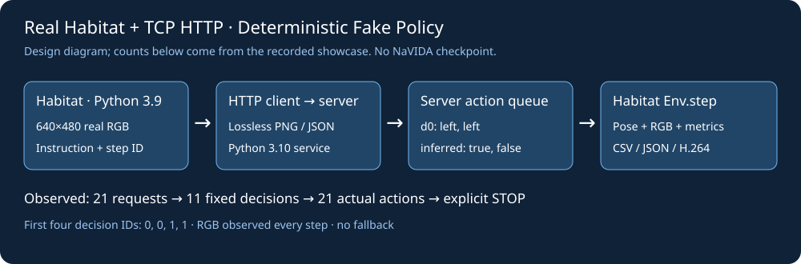

# NaVIDA–Habitat · SURF navigation systems engineering

[中文](README.zh-CN.md) · [Reproduce the Demo](docs/engineering-demo.md) · [Provenance](docs/evaluator-provenance.md) · [Historical validation](docs/validation-report.md)

Connect a visual-language navigation policy to Habitat through a strict,
stateful HTTP interface while keeping incompatible model and simulator stacks
in separate processes. Preserve every decision, executed action and terminal
state so a working pipeline can be distinguished from navigation success.

**Project status: COMPLETED (2026-11-15) — real NaVIDA model integration plus post-SURF Habitat engineering consolidation.** During SURF, the official NaVIDA-3B checkpoint was loaded with 4-bit NF4 inference on an RTX 4060 Ti 8GB and exercised through the HTTP/Habitat path (a five-step connectivity smoke and an 80-step goal-grounded episode). The 80-step episode completed execution but **did not reach its goal** (success=0, SPL=0, final distance ≈8.620m). After SURF, the migrated Habitat 0.3.3 runtime and HTTP/Runner pipeline were revalidated with a clearly labelled **Deterministic Fake Policy** showcase; that later showcase is not a NaVIDA inference run. No successful learned-navigation result, official VLN benchmark or robot deployment is claimed. Final acceptance: [docs/evaluator-migration-acceptance.md](docs/evaluator-migration-acceptance.md).

## Post-SURF engineering showcase (Deterministic Fake Policy)



**[Watch the labelled 10.5-second Demo](docs/assets/engineering-demo.mp4)** ·
[Actual pose data](docs/assets/showcase-poses.csv) · [Evidence](docs/assets/showcase-evidence.json)



One fixed start, one run: **21 actions, 21 HTTP requests, 11 fixed decisions,
0 collisions and explicit STOP**, at 640×480. Two queued actions share their
originating decision; every simulator step supplies a fresh real RGB frame.
Playback is 2 fps; logical control is 1 Hz with wall-clock pacing disabled.
These counts demonstrate execution and recording, not task-solving ability.

## Architecture and protocol



| Process | Responsibilities | Environment |
|---|---|---|
| Model/service | Checkpoint runtime or explicit test policy; RGB history; strict parser; episode state and action queue | Python 3.10 |
| Evaluator | Real Habitat RGB; lossless PNG/base64 HTTP client; unchanged valid actions; trajectory, metrics and media | Python 3.9, Habitat-Lab/Sim 0.3.3 |

`GET /health`, `POST /v1/episodes/start`, `POST /v1/steps` form the integration
seam. Episode reset clears history/queue. Queue consumption preserves
`decision_step` and sets `inferred=false`; only an empty queue requests another
decision. The model receives RGB/history/instruction, never privileged target
distance/bearing, simulator pose, depth, GPS or maps. `paper_pure` bypasses the
controller: invalid output terminates without random/forward fallback or
hidden Oracle/goal-distance STOP. Real checkpoint parsing selects at most two
sub-chunks and expands 25cm/15° actions. The Fake Policy directly supplies fixed
atomic actions and does not test learned inference or parser quality.

## What has actually been verified

| Evidence | Result | Boundary |
|---|---|---|
| Stage A | Real scene/navmesh/config/reset, RGB rendered through WSLg D3D12 | Local environment, no policy |
| Stage B | Forward **0.249999864m**, turns ≈15°, double-left ≈30°, STOP ended episode | Real measured motion |
| Stage C | Normal: 4 requests / 4 actions; invalid: 3 requests / **2 actions**, explicit failure | Real TCP and simulator; Fake Policy |
| Showcase | 640×480, 21 actions, H.264, CSV/JSON/raw RGB, terminal pose | Fixed sequence, not navigation reasoning |

Final local verification: Python 3.10 model-side suite **98 passed, 1 skipped**; Python 3.9 evaluator-side suite **56 passed**. GitHub CI also passed. CI uses fakes and does **not** launch Habitat or download scenes/checkpoints.
[Demo guide](docs/engineering-demo.md) documents commands, versions, outputs and
recording semantics. Selected small presentation derivatives are versioned;
large raw recordings remain local/ignored.

## Reproduce without a checkpoint

Use already prepared independent environments and legally obtained test assets.
The scripts never install packages or download data automatically.

```bash
MODEL_PYTHON=/usr/bin/python3.10
HABITAT_PYTHON=/path/to/habitat-env/bin/python
SCENES_DIR=/path/to/habitat-test-scenes
PYTHONDONTWRITEBYTECODE=1 timeout 240s "$MODEL_PYTHON" scripts/run_engineering_demo.py \
  --habitat-python "$HABITAT_PYTHON" \
  --scenes-dir "$SCENES_DIR" \
  --output-dir outputs/engineering-demo
```

Replace paths and renderer device settings for another machine. The default
21-action sequence is bounded by 24 steps and 180 seconds; `--case invalid`
reproduces the failure path. No `/tmp` script is required. For authorized real
checkpoint inference, see the [model/evaluator quickstart](habitat_vln/README.md).
Do not install the Python 3.10 root package into the evaluator environment.

```bash
PYTHONPATH=src "$MODEL_PYTHON" -m unittest discover -s tests -v
"$HABITAT_PYTHON" -m unittest discover -s test -v
```

## Historical real-checkpoint NaVIDA experiments (SURF)

The SURF project has concluded. The official NaVIDA-3B checkpoint was genuinely loaded and called using 4-bit NF4 inference on the RTX 4060 Ti 8GB; the recorded peak allocated GPU memory was approximately 3.12 GiB. The historical five-step PointNav smoke used a manually supplied instruction that was not aligned with the random PointNav goal, so it establishes real-model inference and integration connectivity, not navigation success.

The later [team PR #5](https://github.com/RtimesC/habitat-lab/pull/5) ran an **80-step goal-grounded episode using the real checkpoint**. The model returned valid actions and completed execution, but stopped at the wrong location: **success=0, SPL=0, final distance ≈8.620m**. A separate Oracle succeeded; that is **not** NaVIDA success.

The November migration/showcase work did not reload the checkpoint after the old model cache was removed. Its 640×480 media uses a Deterministic Fake Policy to validate the migrated software pipeline. These are two distinct evidence sets: historical real-model inference/navigation attempt versus post-SURF Fake Policy engineering validation. A new checkpoint replay in the consolidated repository, R2R/RxR benchmarks and robot work remain optional future experiments.

## Contribution and reuse

The personal model-side runtime, parser, history, Policy API and HTTP service
were developed by sceneeeee/evenS with Codex assistance. Account-linked team
PRs [#4](https://github.com/RtimesC/habitat-lab/pull/4) and
[#5](https://github.com/RtimesC/habitat-lab/pull/5) added the evaluator HTTP
adapter and grounded Demo. The general evaluator framework came from the
**SURF team**, not solely the personal owner. The 35-file import is based on
`RtimesC/habitat-lab@835ac41e`; original blob hashes and subsequent differences
remain in the [manifest](docs/evaluator-source-manifest.json).

[Meta's original MIT notice](third_party/habitat-lab-MIT.LICENSE) is preserved.
No repository-wide license for personal model-side code has been selected.
NaVIDA, Habitat, scenes and datasets retain their respective authors/terms.
This repository does not redistribute weights, GLB/navmesh or datasets.
See the [contribution audit](docs/contribution-audit.md) and
[Chinese SURF closeout](docs/surf-closeout.zh-CN.md).

## Limits

One scene and a fixed Fake Policy test establish engineering behavior, not
generalization or navigation ability. CSV legacy pose/image are before-action,
metrics are after-action; `state_timing` makes this explicit and episode JSON
now records the final pose. Failed video generation reports a diagnostic;
detailed codec errors remain a possible follow-up. Semantic scene annotations,
real checkpoint replay and cross-platform rendering are not validated by this
showcase. [Legacy model-side README](docs/legacy-model-side-readme.zh-CN.md) is
retained as historical reference.
