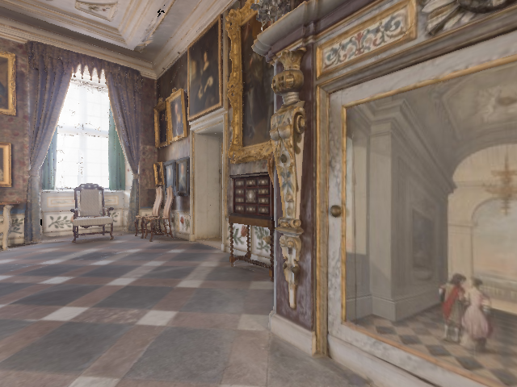
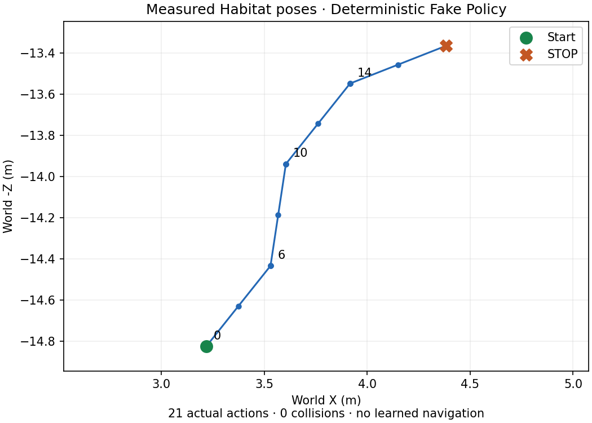
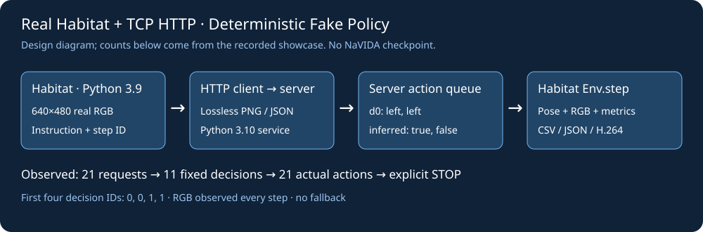

# NaVIDA–Habitat：SURF 导航系统工程

[English](README.md) · [Demo 复现说明](docs/engineering-demo.md) · [代码来源](docs/evaluator-provenance.md) · [历史验证记录](docs/validation-report.md)

项目解决的工程问题：在互不兼容的模型与仿真环境间，通过有状态 HTTP
把 RGB 与指令转换为可审计的原子动作，并记录决策、真实执行和终态，
使“链路可运行”和“导航任务成功”能够被分别判断。

**项目状态：已结项（2026-11-15）——真实 NaVIDA 模型集成与后续 Habitat 工程整合均已完成。** SURF 期间确实加载并运行过官方 NaVIDA-3B checkpoint：RTX 4060 Ti 8GB、4-bit NF4；完成五步真实模型联调，并在团队评估仓库完成一次80步目标对齐实验。该80步实验正常执行但未到达目标（success=0、SPL=0、最终距离约8.620m）。SURF 结束后，个人仓库迁移后的 Habitat 0.3.3 与 HTTP/Runner 链路使用 **Deterministic Fake Policy** 重新验收；下面的视频不是 NaVIDA 推理结果。项目没有声称成功的学习式导航、正式 VLN benchmark 或实机部署。最终验收见 [docs/evaluator-migration-acceptance.md](docs/evaluator-migration-acceptance.md)。

## 后续工程整合展示（Deterministic Fake Policy）



**[观看带 Fake Policy 标注的10.5秒视频](docs/assets/engineering-demo.mp4)** ·
[实际 pose 数据](docs/assets/showcase-poses.csv) · [小型验证记录](docs/assets/showcase-evidence.json)



同一起点、一次运行：**21个动作、21次HTTP请求、11次固定决策、0碰撞，最终显式STOP**。
没有更换起点筛选结果。逻辑控制频率1Hz，关闭墙钟限速；视频采用2fps播放，
不代表模型推理速度或仿真实时吞吐量。演示证明执行与记录链路，不证明导航成功。

## 双进程架构



| 进程 | 职责 | 环境 |
|---|---|---|
| 模型/服务端 | checkpoint或显式测试策略、RGB历史、严格parser、episode状态与动作队列 | Python3.10 |
| 评估端 | Habitat真实RGB、PNG/base64客户端、原子动作执行、轨迹/指标/媒体 | Python3.9、Lab/Sim0.3.3 |

HTTP接口为 `/health`、`/v1/episodes/start`、`/v1/steps`。
消费队列时保留原 `decision_step`、标记 `inferred=false`，队列为空才重新决策。
`paper_pure`只给模型RGB、有限历史和自然语言指令，不提供目标距离/方位、pose、
深度、GPS或地图；有效动作绕过控制器，无效输出直接失败，无随机/前进fallback或隐藏Oracle。
真实模型parser最多执行前两个sub-chunk，按25cm/15°展开。
Fake Policy直接返回固定原子动作，不验证模型能力或代替parser回归测试。

## 实际验证

- A：真实场景、navmesh、配置和reset通过，WSLg D3D12渲染。
- B：前进 **0.249999864m**，左右转约15°，连续两左转约30°，STOP正常结束。
- C：正常用例4请求/4动作；无效用例3请求但只有**2次Env.step**，明确失败且无替代动作；
  两用例均生成H.264，并验证了正常/异常资源清理。
- 本次展示：640×480、21动作、真实RGB/CSV/JSON/H.264及终态pose。

最终本地回归：Python 3.10模型端 **98通过、1跳过**；Python 3.9评估端 **56通过**。GitHub Actions亦通过；**CI不启动真实Habitat或下载资产**。
原始大文件保留本地ignored目录，仅提交少量精选展示素材。

## 复现命令

已有独立环境和合法场景后，在仓库根目录执行：

```bash
MODEL_PYTHON=/usr/bin/python3.10
HABITAT_PYTHON=/path/to/habitat-env/bin/python
SCENES_DIR=/path/to/habitat-test-scenes
PYTHONDONTWRITEBYTECODE=1 timeout 240s "$MODEL_PYTHON" scripts/run_engineering_demo.py \
  --habitat-python "$HABITAT_PYTHON" \
  --scenes-dir "$SCENES_DIR" \
  --output-dir outputs/engineering-demo
```

其他机器需替换解释器/场景路径及渲染设备设置。脚本不安装环境或下载模型，
不依赖 `/tmp` 临时脚本。单回合默认21动作，最多24步、子进程180秒超时。
`--case invalid`复现无效输出路径。具体产物、版本、播放频率和字段语义见
[Demo说明](docs/engineering-demo.md)。不要把根目录Python3.10依赖安装进评估环境。

```bash
PYTHONPATH=src "$MODEL_PYTHON" -m unittest discover -s tests -v
"$HABITAT_PYTHON" -m unittest discover -s test -v
```

## SURF期间的真实 NaVIDA 模型实验

SURF 期间确实运行过官方 NaVIDA-3B checkpoint，而不是只使用 Fake Policy。个人仓库 [PR #6](https://github.com/sceneeeee/navida-habitat/pull/6) 记录了 RTX 4060 Ti 8GB 上的 4-bit NF4 加载与推理，peak allocated GPU memory 约 3.12 GiB；同时完成了五步真实模型 Habitat/HTTP smoke test。该 smoke test 的手动指令与随机 PointNav 目标不匹配，因此证明真实推理与工程连通性，不证明导航成功。

随后团队评估仓库的[PR #5](https://github.com/RtimesC/habitat-lab/pull/5)记录了一次80步目标对齐真实模型 episode。NaVIDA 输出合法动作并完成执行，但在错误位置 STOP：**success=0、SPL=0、最终目标距离约8.620m**。独立 Oracle 的成功结果只验证场景和评估流程，不属于 NaVIDA 成绩。

## 后续工程整合展示（Fake Policy）

11月迁移后的个人仓库没有重新加载旧 checkpoint。后续真实 Habitat 0.3.3、HTTP Client/Server、NavigationRunner 和媒体链路验收使用 Deterministic Fake Policy。该展示验证的是软件工程执行，不是模型推理。当前本地 checkpoint 已随旧环境清理而不在已验证环境中；未来重新获取授权权重并重放属于可选后续实验。标准 R2R/RxR benchmark 和实机验证也未完成。

个人模型端的runtime、parser、历史帧、Policy API和HTTP由sceneeeee/evenS与Codex辅助开发。SURF期间真实checkpoint加载与推理的历史证据见上文及个人仓库PR #6；
该账号在团队PR #4/#5中贡献了评估HTTP适配器及grounded Demo；
通用runner/controller/environment框架来自**SURF团队**，不能全部视为个人原创。
35文件初始快照为 `835ac41e`，原始SHA与下游改动均保留在
[manifest](docs/evaluator-source-manifest.json)，[Meta MIT许可](third_party/habitat-lab-MIT.LICENSE)
与[贡献边界](docs/contribution-audit.md)不变。个人模型端尚未选择仓库级许可证；当前结项不擅自替仓库所有者选择许可证。
不提交权重、GLB/navmesh、数据集、原始大视频或temp_report.md。

CSV旧pose/image字段对应动作前，metrics对应动作后；现在有明确的`state_timing`，
摘要另存终态pose及采集错误。视频返回False会记录诊断，但详细codec错误仍可改进。
当前单场景固定序列不支持泛化或导航能力结论，语义标注与跨平台渲染也未充分验证。
