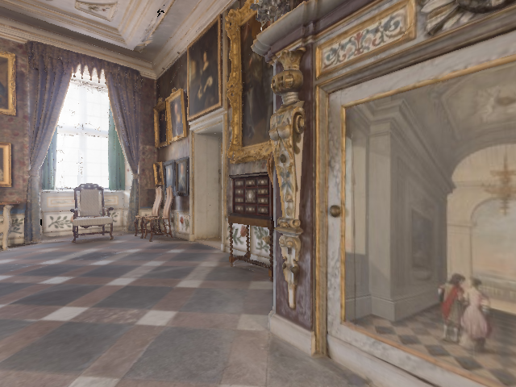

# Real Habitat + HTTP engineering Demo

**Deterministic Fake Policy; no NaVIDA inference, training or benchmark.**
This is a fixed-action systems test in the real `skokloster-castle` scene.
It does not follow the navigation instruction or optimize the goal metric.



[Watch the labelled H.264 clip](assets/engineering-demo.mp4) ·
[Measured trajectory](assets/habitat-trajectory.png) ·
[HTTP/queue flow](assets/http-flow.svg) ·
[Small evidence record](assets/showcase-evidence.json) ·
[All measured poses](assets/showcase-poses.csv)

## Recorded run

One run, original Stage A start, no trajectory selection or resampling.
640×480 RGB; 21 actual actions, 21 HTTP requests, 11 fixed decisions;
0 collisions; explicit STOP. The first two actions share decision 0 and have
`inferred=true,false`. The full fixed sequence is in `SHOWCASE` in
`scripts/run_engineering_demo.py` and the evidence JSON.

Initial position: `[3.218496799, 0.209918618, 14.824010849]`.
Final position: `[4.382125854, 0.209918618, 13.365238190]`.
Both endpoint quaternions and offline metrics are in the evidence JSON.
No task-success claim is made. The fake run's success/SPL were both zero.

Video: H.264, 640×480, 21 frames, **2 fps / 10.5 seconds**. The logical control
rate is **1 Hz**, with wall-clock pacing disabled; 2 fps is presentation playback,
not a measured simulator or model inference throughput. Raw RGB has no overlay;
the compact web clip adds an explicit Fake Policy banner to the Runner video.
The trajectory plot uses actual recorded world X and -Z positions, with equal
axis scale. The SVG is a design diagram whose displayed counts were checked
against the run, not a screenshot of runtime internals.

## Reproduce with existing dependencies and assets

The service uses Python 3.10 with Pillow. The evaluator uses a separate Python
3.9, Habitat-Lab/Sim 0.3.3, NumPy 1.26.4, OpenCV 4.10, Pillow 10.4,
Hydra 1.3.2, OmegaConf 2.3 and quaternion 2023.0.4. Source baseline:
SURF `835ac41e`. Keep the environments separate. No automatic installation,
scene or checkpoint download occurs. Obtain authorized GLB/navmesh first.
The original MIT and contributor record are in [provenance](evaluator-provenance.md).

From this repository root, after setting the interpreter and scene paths for the target machine:

```bash
MODEL_PYTHON=/usr/bin/python3.10
HABITAT_PYTHON=/path/to/habitat-env/bin/python
SCENES_DIR=/path/to/habitat-test-scenes
PYTHONDONTWRITEBYTECODE=1 timeout 240s "$MODEL_PYTHON" scripts/run_engineering_demo.py \
  --habitat-python "$HABITAT_PYTHON" \
  --scenes-dir "$SCENES_DIR" \
  --output-dir outputs/engineering-demo
```

On other machines, replace interpreter/scene paths and select a suitable
`--gpu-device-id`; `-1` is the tested WSLg setting, not universal.
Use `--case normal` or `--case invalid` for the short Stage C scenarios.
Each run is a single fixed-start episode, at most 24 runner ticks, task limit
24 steps/90 seconds and subprocess timeout 180 seconds. Ten two-action chunks
plus STOP produce the default 21-step showcase. No random/goal-aware fallback.

The output prints `DEMO_RUN <directory>`. It contains the generated fixture,
bounded/effective configs, actual command, HTTP request/response logs, decoded
RGB hashes, raw PNGs, audit before/after poses, terminal state and lifecycle.
The unmodified CLI module and shared NavigationRunner generate nested
`trajectory.csv`, `episode_summary.json`, `summary.md`, JPEG frames and `run.mp4`.
The audit wrapper delegates to the real Env/client functions; it does not
replace HTTP transport or simulator observations. Base64 payloads are not logged.

Optional small-asset export (requires existing Matplotlib, ffmpeg/libx264 and
ffprobe; never invokes a simulator):

```bash
HABITAT_PYTHON=/path/to/habitat-env/bin/python
MPLCONFIGDIR=/tmp/navida-mpl "$HABITAT_PYTHON" \
  scripts/export_engineering_demo.py --run-dir /absolute/path/printed/by/DEMO_RUN \
  --asset-dir docs/assets
```

The exporter checks queue IDs, pixel hashes, action/CSV correspondence, terminal
pose, H.264 codec/frame count and a 2 MiB ceiling on the curated clip. Preserve
raw outputs locally; do not overwrite them with presentation derivatives.
The reviewed source checkout is required in addition to the Conda/pip environment.

## Evidence boundary and recording semantics

- A: real import/config/scene/reset passed, WSLg D3D12 on RTX 4060 Ti.
- B: forward 0.249999864 m; single left/right about 15°, double left about 30°;
  STOP ended the episode. Angle tolerance 0.05°, displacement tolerance 0.01 m.
- C: normal case had 4 requests/4 Env steps; invalid case had 3 requests but only
  2 Env steps, `invalid_model_output`, no replacement action, `failed=true`.
  Both produced readable H.264. Normal/exception server cleanup passed.
- Showcase: the larger fixed-action run described above, not another model experiment.

CSV legacy pose/image fields are **before action**, metrics are **after action**
(or unchanged when no action executes). `state_timing` now says this explicitly.
`episode_summary.json` contains final pose in metres and quaternion **xyzw**, or
an explicit `final_pose_error`; the audit also preserves before/after states.
`inference_ran` means the client was called; `policy_inferred` distinguishes a
server decision from a queued action. Invalid output adds a terminal diagnostic
row without a simulator step. CLI exit 0 alone does not imply episode success:
inspect `failed`, `stopped` and the error fields.

Video False results now receive a nonempty diagnostic. The generic message
cannot identify every codec fault; a structured encoder error API remains a
possible follow-up. Screenshots are real simulation outputs; the licensed GLB,
navmesh, model weights and large raw artifacts are not redistributed here.
Missing semantic annotations and duplicate-importer warnings remain in raw logs;
only RGB/PointNav behavior is validated. Real checkpoint re-evaluation and
standard R2R/RxR or physical-robot validation remain outside this delivery.

The original raw run directory is retained locally outside the repository and is intentionally not versioned. The committed evidence JSON, pose CSV and selected presentation assets are derived from that single run; see the repository scripts and provenance record for the implementation.
